# Chương 5. AI trong Thiết kế & Kiến trúc Phần mềm (AI in Software Architecture & Design)

---

## 1. Tổng Quan & Vai Trò Của AI Trong Thiết Kế Kiến Trúc Phần Mềm

Thiết kế kiến trúc và mô hình hóa hệ thống phần mềm là giai đoạn chuyển hóa các yêu cầu nghiệp vụ và tài liệu phân tích (PRD, Feature Specs) thành bản thiết kế kỹ thuật vững chắc, có khả năng mở rộng, bảo mật và vận hành ổn định. Trong các phương pháp kỹ nghệ truyền thống, việc thiết kế kiến trúc thường phụ thuộc nặng nề vào trực giác và kinh nghiệm cá nhân của Software Architect, dẫn tới nguy cơ:
- Bỏ sót các xung đột giữa các thuộc tính chất lượng (Quality Attribute Conflicts - ví dụ: Hiệu năng cao vs. Toàn vẹn dữ liệu nghiêm ngặt).
- Rò rỉ ranh giới kiến trúc (Architectural Boundary Leaks & Architectural Drift) trong quá trình phát triển mã nguồn.
- Mất nhiều thời gian để phác thảo, đồng bộ và cập nhật sơ đồ UML khi mã nguồn thay đổi.
- Thiết kế CSDL và API thiếu tính nhất quán, dễ gặp lỗi Deadlock, Race Condition hoặc vi phạm chuẩn RESTful.

Với sự tiến bộ vượt bậc của **Generative AI** và các mô hình ngôn ngữ lớn (LLMs), quy trình này được nâng cấp thành **AI-Assisted Software Architecture & System Engineering**. AI hoạt động như một **AI Architect Co-pilot**, đóng vai trò phản biện, tạo sinh tài liệu quyết định kiến trúc (ADRs), mô hình hóa hệ thống bằng mã (Diagram-as-Code), thiết kế lược đồ cơ sở dữ liệu tối ưu, sinh hợp đồng API (OpenAPI Specs) và đề xuất các mẫu thiết kế (Design Patterns) phù hợp nhất cho dự án **Finance Manager** (Ứng dụng quản lý tài chính cá nhân đa nền tảng Flutter & NestJS).

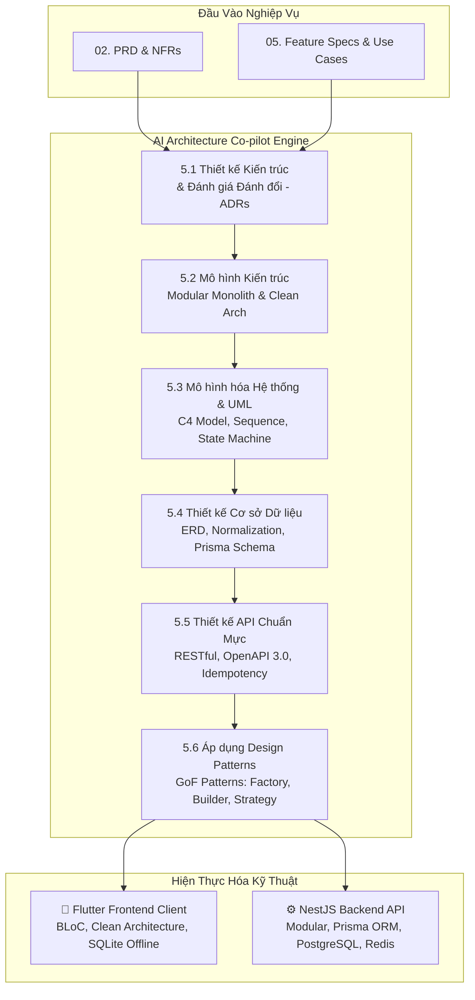

---

## 5.1 Thiết Kế Kiến Trúc (Architectural Design)

### 5.1.1 Khái Niệm & Vai Trò Của AI trong Thiết Kế Kiến Trúc
Thiết kế kiến trúc phần mềm là nghệ thuật và khoa học xác định cấu trúc tổng thể của hệ thống, bao gồm các thành phần phần mềm, mối quan hệ giữa chúng và các nguyên tắc chỉ đạo việc thiết kế và tiến hóa của chúng.

Trong dự án **Finance Manager**, AI đóng vai trò:
1. **Phân tích yêu cầu phi chức năng (NFRs Analysis)**: Tự động trích xuất các chỉ số định lượng về hiệu năng, tải, bảo mật từ PRD và quy đổi thành các ràng buộc kiến trúc kỹ thuật.
2. **Đánh giá đánh đổi kiến trúc (Architecture Trade-off Analysis)**: Phân tích ưu/nhược điểm giữa các phong cách kiến trúc đối nghịch (Monolith vs. Microservices, Offline-First vs. Cloud-Centric) dựa trên ràng buộc thực tế về nguồn lực và thời gian phát triển.
3. **Soạn thảo Bản ghi Quyết định Kiến trúc (Architectural Decision Records - ADRs)**: Tự động cấu trúc hóa các quyết định kỹ thuật quan trọng theo chuẩn định dạng Markdown, lưu trữ trực tiếp vào kho mã nguồn (Git) để đảm bảo tính minh bạch và lịch sử tiến hóa.

### 5.1.2 Đánh Giá Thuộc Tính Chất Lượng (Quality Attributes & NFRs)
Một kiến trúc tốt phải thỏa mãn đồng thời các thuộc tính chất lượng then chốt của bài toán tài chính cá nhân:

| Thuộc Tính Chất Lượng | Ràng Buộc Kỹ Thuật Trong Finance Manager | Giải Pháp Kiến Trúc Được AI Đề Xuất |
|---|---|---|
| **Hiệu năng (Performance)** | - Phản hồi UI dưới 100ms khi nhập giao dịch.<br>- API đọc Dashboard < 150ms tại P95. | - Caching Redis cho tổng hợp thu chi.<br>- Snapshot số dư ví trên bảng `wallets`.<br>- Composite B-Tree Index trên `(userId, date DESC)`. |
| **Khả năng mở rộng (Scalability)** | - Hệ thống chịu tải 10,000 DAU v1.0, sẵn sàng mở rộng 1,000,000 DAU v2.0. | - Kiến trúc **Modular Monolith** trên NestJS, đóng gói ranh giới domain rõ ràng, dễ tách thành Microservices khi tải tăng cao. |
| **Tính sẵn sàng & Ngoại tuyến (Offline Resilience)** | - Người dùng có thể ghi chép ngay cả khi mất mạng (trên máy bay, vùng sâu vùng xa). | - **Local-First Architecture**: Flutter lưu dữ liệu vào local SQLite/Isar trước, đồng bộ ngầm (Background Sync) khi có mạng. |
| **Bảo mật (Security)** | - Bảo mật tuyệt đối số liệu tài chính cá nhân.<br>- Chống rò rỉ dữ liệu khi mất điện thoại. | - Mã hóa dữ liệu tĩnh (AES-256) trên local DB.<br>- JWT Access/Refresh Token với HttpOnly/Secure Cookie.<br>- Chuẩn hóa xác thực đa lớp. |
| **Toàn vẹn dữ liệu (Data Integrity)** | - Không bao giờ xảy ra tình trạng mất tiền hoặc số dư sai lệch do race conditions. | - PostgreSQL RDBMS với ACID Transactions.<br>- Pessimistic/Optimistic Locking khi cập nhật số dư ví.<br>- Audit Log ghi lại mọi biến động số dư. |

### 5.1.3 Phân Tích Đánh Đổi Kiến Trúc (Architecture Trade-off Analysis)

AI đã hỗ trợ đội ngũ kỹ thuật phân tích các cặp đánh đổi trọng yếu:

#### 1. Đánh đổi: Monolith vs. Microservices vs. Modular Monolith
* **Thực trạng**: Nhiều dự án vội vã chọn Microservices gây phân mảnh mạng, độ phức tạp DevOps vượt quá nguồn lực nhóm nhỏ.
* **Đề xuất từ AI**:
  - Chọn **Modular Monolithic Architecture** cho giai đoạn hiện tại.
  - Mỗi tính năng nghiệp vụ (`Auth`, `Wallets`, `Transactions`, `Budgets`, `Reports`) là một NestJS Module biệt lập với ranh giới Domain rõ ràng. Giao tiếp giữa các module thông qua Module Interfaces hoặc Internal Event Bus.
  - Lộ trình: Khi một Module (ví dụ `Reports` hoặc `BankSyncEngine`) có tải tăng vọt, chỉ cần tách module đó thành Microservice độc lập mà không cần viết lại toàn bộ mã nguồn.

#### 2. Đánh đổi: Cloud-First vs. Local-First (Offline Support)
* **Thực trạng**: Cloud-First đơn giản trong việc đảm bảo tính nhất quán (Single Source of Truth), nhưng biến ứng dụng thành "vô dụng" khi mất kết nối mạng.
* **Đề xuất từ AI**:
  - Lựa chọn **Local-First Architecture** với chiến lược đồng bộ **Last-Write-Wins (LWW)** dựa trên UUIDv4 và Client Timestamp (UTC).
  - Client ghi dữ liệu tức thì vào Local Database (< 10ms), tạo trải nghiệm mượt mà, sau đó một Worker Service ngầm sẽ đẩy dữ liệu lên API khi mạng phục hồi.

### 5.1.4 Bản Ghi Quyết Định Kiến Trúc (Architectural Decision Records - ADRs)

#### ADR-001: Lựa Chọn Mô Hình Modular Monolith Với NestJS và Clean Architecture Với Flutter

```markdown
# ADR-001: Lựa Chọn Kiến Trúc Modular Monolith (Backend) và Clean Architecture (Frontend)

## Trạng Thái (Status)
Đã Phê Duyệt (Accepted) - 2026-10-13

## Ngữ Cảnh (Context)
Ứng dụng Finance Manager yêu cầu thời gian ra mắt thị trường nhanh (v1.0), tài nguyên hạ tầng ban đầu khiêm tốn, nhưng đòi hỏi độ ổn định cao, phân chia ranh giới domain mạch lạc để sẵn sàng scale lên hàng triệu người dùng trong tương lai.

## Quyết Định (Decision)
1. Backend: Triển khai kiến trúc **Modular Monolith** sử dụng **NestJS (TypeScript)** và **PostgreSQL** với Prisma ORM.
   - Mỗi domain (`Auth`, `Wallets`, `Transactions`, `Budgets`, `Reports`) là một module độc lập.
   - Truy cập chéo domain phải thông qua Service Interface, nghiêm cấm truy vấn trực tiếp bảng của domain khác.
2. Frontend: Triển khai **Clean Architecture** kết hợp mô hình quản lý trạng thái **BLoC (Business Logic Component)** trên **Flutter**.
   - Tách biệt tuyệt đối 3 tầng: `Presentation Layer`, `Domain Layer`, `Data Layer`.

## Hệ Quả (Consequences)
- **Tích cực**:
  + Chi phí triển khai và kiểm thử hạ tầng thấp (1 container duy nhất trên Cloud).
  + Tránh được overhead phân tán (Network latency, Distributed Transactions).
  + Mã nguồn sạch sẽ, dễ dàng tách thành Microservices khi tải vượt ngưỡng 100,000 DAU.
- **Tiêu cực**:
  + Cần tuân thủ kỷ luật nghiêm ngặt về kiểm tra phụ thuộc (Dependency Linting) để tránh Circular Dependency giữa các module.
```

#### ADR-002: Cơ Chế Đồng Bộ Ngoại Tuyến (Offline-First Sync) Với UUIDv4 và Last-Write-Wins (LWW)

```markdown
# ADR-002: Kiến Trúc Đồng Bộ Ngoại Tuyến Sử Dụng UUIDv4 và Last-Write-Wins

## Trạng Thái (Status)
Đã Phê Duyệt (Accepted) - 2026-10-13

## Ngữ Cảnh (Context)
Người dùng cần nhập liệu giao dịch chi tiêu trong mọi điều kiện kết nối mạng với độ trễ phản hồi tức thì (< 50ms). Khi kết nối mạng phục hồi, dữ liệu cục bộ cần đồng bộ hóa toàn vẹn với Cloud Server mà không làm mất mát dữ liệu hoặc tạo ra các bản ghi trùng lặp.

## Quyết Định (Decision)
1. Tất cả các khóa chính của bảng Giao dịch (`Transaction`), Ví (`Wallet`), Ngân sách (`Budget`) đều sử dụng chuỗi định danh toàn cầu duy nhất **UUIDv4** được sinh trực tiếp tại Client.
2. Mỗi bản ghi cục bộ bao gồm trường metadata: `sync_status` (PENDING, SYNCED, FAILED) và `client_updated_at` (UTC ISO 8601).
3. Khi đồng bộ, Server áp dụng giải thuật **Last-Write-Wins (LWW)**:
   - Nếu UUID chưa tồn tại trên Server: Thực thi `INSERT` và trả về `status = SYNCED`.
   - Nếu UUID đã tồn tại: So sánh `client_updated_at` và `server_updated_at`. Bản ghi có thời gian mới hơn sẽ được áp dụng cập nhật.
4. Kiểm toán giao dịch (Audit Ledger): Cập nhật số dư ví trên server luôn thực hiện trong Database Transaction (`SERIALIZABLE` hoặc `SELECT FOR UPDATE`) để ngăn chặn Race Condition.

## Hệ Quả (Consequences)
- **Tích cực**: Thao tác người dùng luôn mượt mà; không bị nghẽn mạng; giải quyết xung đột có tính xác định cao (Deterministic).
- **Tiêu cực**: Cần đảm bảo thiết bị người dùng có đồng hồ hệ thống không bị lệch quá lớn (sử dụng NTP Offset nếu cần).
```

---

## 5.2 Các Mô Hình Kiến Trúc (Architecture Patterns)

### 5.2.1 Tổng Quan Các Mô Hình Kiến Trúc Ứng Dụng Trong Hệ Thống

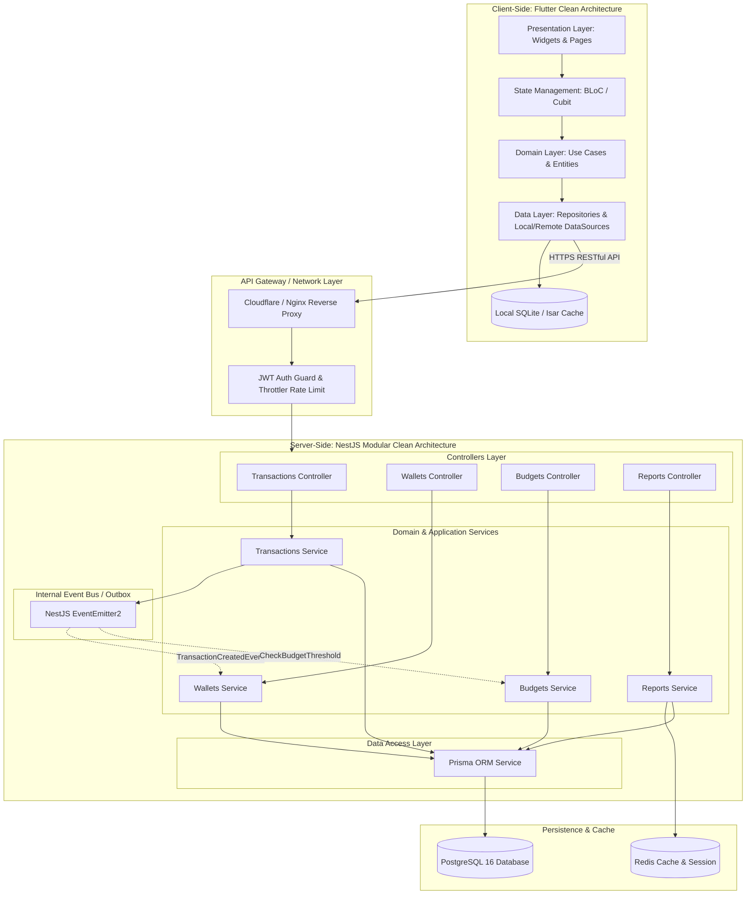

### 5.2.2 Kiến Trúc Clean Architecture Trên Client (Flutter)
AI đã thiết kế cấu trúc phân lớp cho Flutter tuân theo nguyên lý **Inversion of Control (IoC)** và **Single Responsibility Principle (SRP)**:

1. **Presentation Layer**:
   - Chứa UI Widgets, Screens và BLoCs.
   - Chỉ lắng nghe State từ BLoC và phát ra Event, không chứa bất kỳ logic nghiệp vụ tính toán số dư hay gọi API trực tiếp.
2. **Domain Layer (Core Business Rules)**:
   - Chứa các thực thể cốt lõi (`TransactionEntity`, `WalletEntity`, `BudgetEntity`).
   - Chứa các Use Cases (`AddTransactionUseCase`, `CalculateNetWorthUseCase`, `SyncOfflineDataUseCase`).
   - Hoàn toàn độc lập với Flutter Framework (thuần Dart), độc lập với Database và Network.
3. **Data Layer (Data Access & Implementation)**:
   - Chứa Models (kế thừa từ Entity kèm phương thức `fromJson`, `toJson`, `toLocalDbMap`).
   - Chứa Data Sources: `RemoteDataSource` (gọi REST API qua Dio/Http) và `LocalDataSource` (gọi SQLite/Isar).
   - Chứa Repositories Implementation: Thực hiện cơ chế fallback (offline-first).

### 5.2.3 Cấu Trúc Thư Mục Chuẩn Hóa Được AI Thiết Lập

AI đã thẩm định và sinh khung thư mục tiêu chuẩn cho cả hai nền tảng:

#### Cấu Trúc Flutter Frontend (`frontend_app/lib/`)
```
lib/
├── core/                       # Thành phần dùng chung toàn hệ thống
│   ├── constants/              # App constants, API endpoints, colors, typography
│   ├── errors/                 # Exception, Failure classes
│   ├── network/                # NetworkInfo, DioClient interceptors
│   ├── utils/                  # CurrencyFormatter, DateHelper, Validators
│   └── storage/                # SQLite Helper, SecureStorageService
├── data/                       # Tầng Dữ liệu (Data Layer)
│   ├── datasources/
│   │   ├── local/              # Local Database DAOs (transaction_local_dao.dart)
│   │   └── remote/             # Remote API clients (transaction_api_service.dart)
│   ├── models/                 # DTOs & Serialization models (transaction_model.dart)
│   └── repositories/           # Triển khai Repository interfaces (transaction_repo_impl.dart)
├── domain/                     # Tầng Nghiệp Vụ (Domain Layer - Pure Dart)
│   ├── entities/               # Business Entities (transaction_entity.dart)
│   ├── repositories/           # Repository Interfaces (i_transaction_repository.dart)
│   └── usecases/               # Use cases (create_transaction_usecase.dart)
└── presentation/               # Tầng Giao Diện (Presentation Layer)
    ├── blocs/                  # BLoC / Cubit State management
    │   ├── transaction/        # transaction_bloc.dart, transaction_event.dart, transaction_state.dart
    │   ├── wallet/             # wallet_bloc.dart
    │   └── budget/             # budget_bloc.dart
    ├── screens/                # Màn hình ứng dụng (dashboard_screen.dart, add_transaction_modal.dart)
    └── widgets/                # Reusable UI Components (balance_card.dart, numpad_calculator.dart)
```

#### Cấu Trúc NestJS Backend (`backend/src/`)
```
backend/src/
├── common/                     # Filters, Guards, Interceptors, Pipes, Decorators
│   ├── decorators/             # @CurrentUser(), @Public()
│   ├── filters/                # HttpExceptionFilter (RFC 7807)
│   ├── guards/                 # JwtAuthGuard, RolesGuard
│   ├── interceptors/           # LoggingInterceptor, TransformResponseInterceptor
│   └── pipes/                  # CustomValidationPipe, ParseUUIDPipe
├── config/                     # Cấu hình môi trường (database.config.ts, jwt.config.ts)
├── prisma/                     # Prisma Client wrapper & Database Connection Pool
│   ├── prisma.module.ts
│   └── prisma.service.ts
├── modules/                    # Các Domain Modules (Modular Monolith)
│   ├── auth/                   # Authentication (JWT, Register, Login, Reset Password)
│   ├── wallets/                # Quản lý ví, số dư, chuyển tiền nội bộ
│   ├── transactions/           # Ghi chép thu chi, phân loại, đồng bộ ngoại tuyến
│   ├── categories/             # Danh mục cha con 2 cấp, icon, màu sắc
│   ├── budgets/                # Ngân sách tháng, cảnh báo ngưỡng 80% & 100%
│   └── reports/                # Tổng hợp dòng tiền, báo cáo cơ cấu chi tiêu
├── app.module.ts               # Root Module
└── main.ts                     # Bootstrap Server, Swagger, Global Pipes
```

---

## 5.3 Mô Hình Hóa Hệ Thống & UML (System Modeling & UML)

### 5.3.1 Kỷ Nguyên Diagram-as-Code (DaC) Kết Hợp Với AI
Thay vì sử dụng các công cụ kéo thả đồ họa truyền thống (vốn khó version-control và nhanh chóng lạc hậu khi code thay đổi), toàn bộ mô hình hóa của **Finance Manager** được chuyển đổi thành **Diagram-as-Code** (Mermaid.js). AI có thể tự động đọc cấu trúc thư mục, Prisma Schema và NestJS Services để sinh và cập nhật các sơ đồ tương ứng một cách tự động.

### 5.3.2 C4 Model Cho Finance Manager

#### C4 Level 1: Sơ Đồ Ngữ Cảnh Hệ Thống (System Context Diagram)
Biểu diễn vị trí của Finance Manager trong hệ sinh thái người dùng và các dịch vụ bên ngoài:

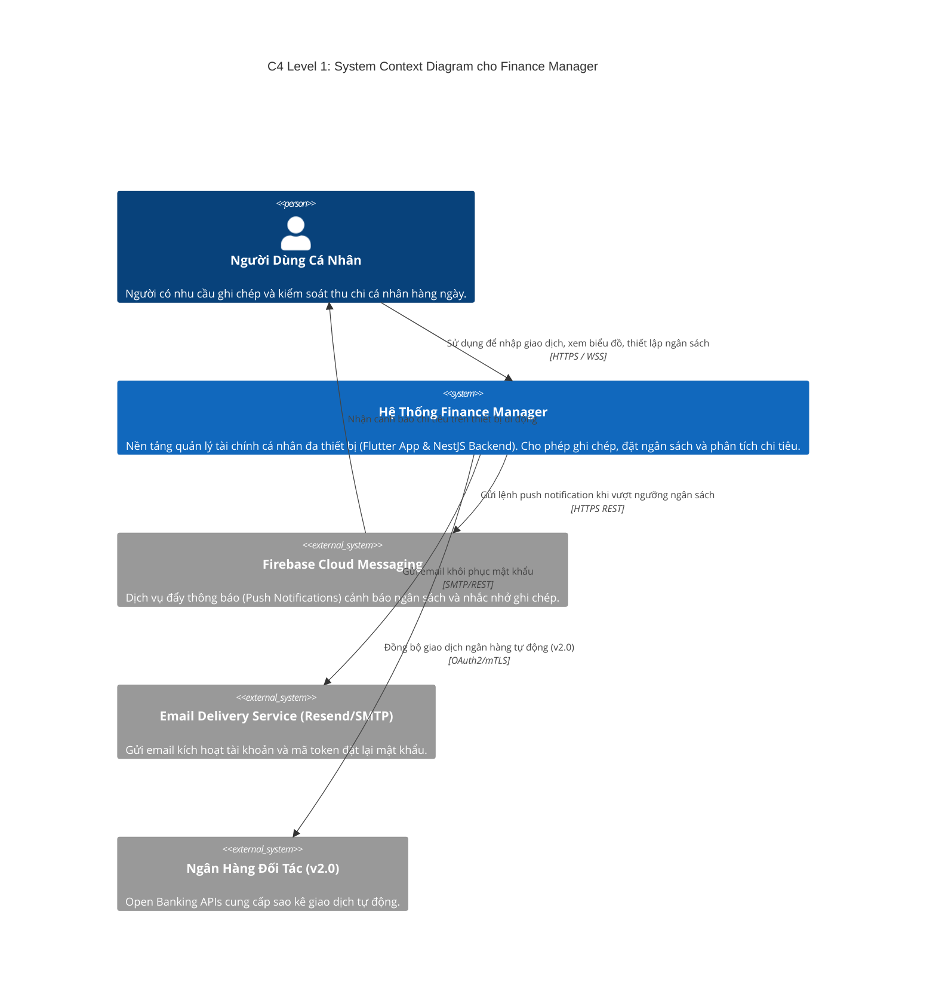

#### C4 Level 2: Sơ Đồ Thùng Chứa (Container Diagram)
Mô tả các khối phần mềm cấp cao (Applications, Databases, Services) cấu thành nên hệ thống:

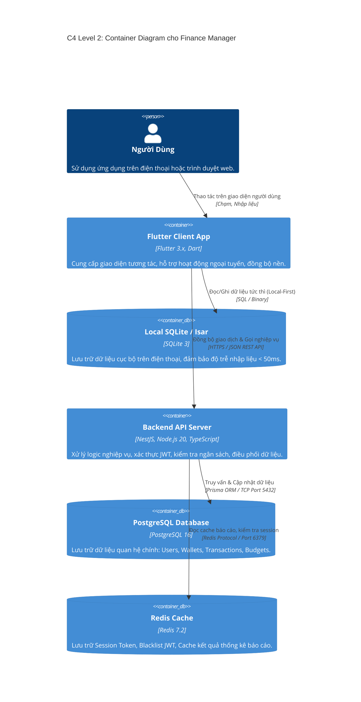

### 5.3.3 Các Biểu Đồ UML Thiết Yếu

#### 1. Biểu Đồ Tuần Tự (Sequence Diagram): Luồng Đồng Bộ Giao Dịch Ngoại Tuyến & Giải Quyết Xung Đột

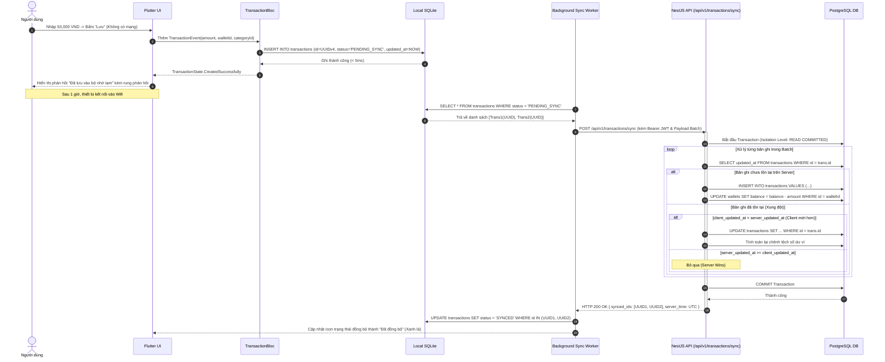

#### 2. Biểu Đồ Trạng Thái (State Machine Diagram): Vòng Đời Cảnh Báo Ngân Sách

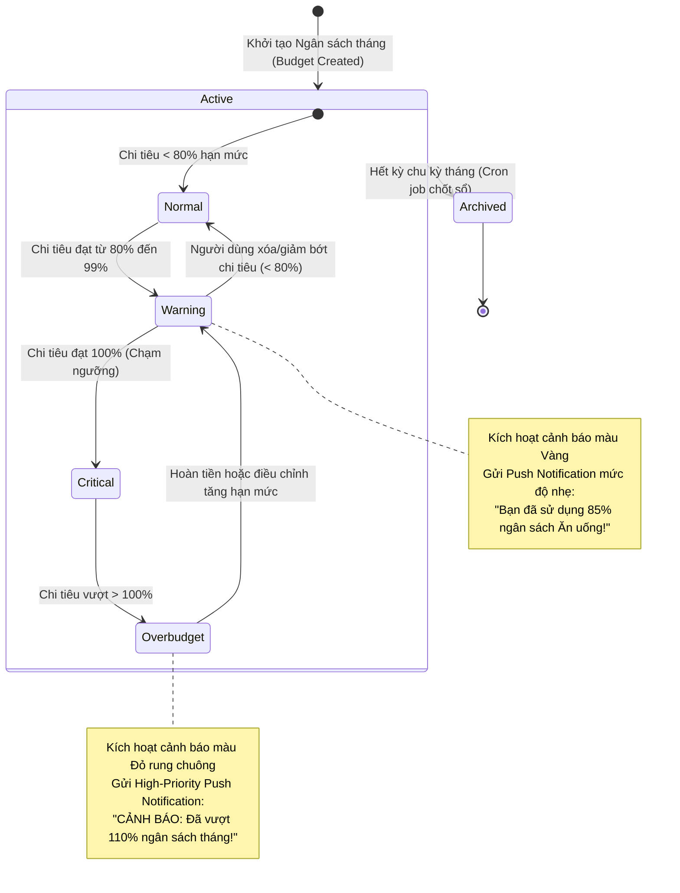

---

## 5.4 Thiết Kế Cơ Sở Dữ Liệu (Database Design)

### 5.4.1 Kiến Trúc Đa Mô Hình Lưu Trữ (Polyglot Persistence Architecture)
Trong các hệ thống tài chính cá nhân hiện đại, không có một công nghệ cơ sở dữ liệu đơn lẻ nào có thể tối ưu đồng thời cho tất cả các bài toán: tính toán tiền tệ nghiêm ngặt (ACID), truy xuất siêu tốc (Sub-millisecond latency), xử lý phi cấu trúc (Hóa đơn ảnh/OCR) và phân tích chuỗi thời gian (Time-series analytics). 

Dưới sự trợ giúp của AI Architect Co-pilot, hệ thống **Finance Manager** được xây dựng trên mô hình **Polyglot Persistence** (Đa mô hình lưu trữ), phân bổ đúng dữ liệu vào đúng công nghệ tối ưu:

| Loại CSDL | Công Nghệ Lựa Chọn | Dữ Liệu Lưu Trữ Đại Diện | Vai Trò & Thuộc Tính Kỹ Thuật Chính |
|---|---|---|---|
| **Relational DB (RDBMS)** | **PostgreSQL 16** (với Prisma ORM) | Users, Wallets, Transactions, Budgets, Debts, Savings Goals | - **Single Source of Truth** cho dữ liệu tài chính.<br>- Đảm bảo tính toán toàn vẹn **ACID**, Foreign Keys, Cascades, Transactions nghiêm ngặt.<br>- Hỗ trợ JSONB cho siêu dữ liệu mở rộng. |
| **In-Memory Cache & Key-Value** | **Redis 7.2** | Cached Dashboard summaries, Session tokens, Idempotency locks, Rate-limit counters, Real-time budget alert flags | - Độ trễ truy xuất cực thấp (< 2ms).<br>- Phục vụ khóa phân tán (`SETNX`) chống trùng lặp giao dịch.<br>- Hỗ trợ Pub/Sub cho thông báo đa thiết bị. |
| **Document & Object Store** | **AWS S3 / MinIO & MongoDB** (Optional) | Ảnh chụp hóa đơn gốc, File xuất báo cáo PDF/Excel, Payload thô trích xuất từ AI OCR | - Lưu trữ dữ liệu phi cấu trúc dung lượng lớn.<br>- Lưu trữ chi tiết từng dòng mặt hàng (line items), mã số thuế từ hóa đơn quét bởi Vision AI. |
| **Time-Series / Analytics DB** | **TimescaleDB / ClickHouse** (Lộ trình v2.0) | Lịch sử biến động số dư theo ngày, Lũy kế dòng tiền qua các năm | - Tối ưu cho các truy vấn phân tích tổng hợp (Aggregations & Rollups) hàng triệu bản ghi.<br>- Phục vụ mô hình Machine Learning dự báo chi tiêu tương lai. |
| **Client Embedded Storage** | **SQLite (sqflite / Drift) + FlutterSecureStorage** | Dữ liệu giao dịch ngoại tuyến, Danh mục, Cài đặt cá nhân, JWT tokens | - **Local-First Resilience**: Phản hồi UI tức thì (< 10ms) khi không có mạng.<br>- Mã hóa an toàn khóa mã hóa qua Android Keystore và iOS Keychain. |

#### So Sánh Kỹ Thuật Lưu Trữ Cục Bộ Trên Flutter (Client-Side Storage Comparison)

AI đã đánh giá và lập ma trận so sánh các giải pháp lưu trữ cục bộ trên thiết bị di động:

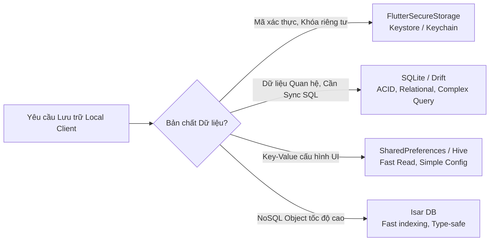

- **Lựa chọn cho Finance Manager**: Kết hợp **Drift/SQLite** cho tầng dữ liệu nghiệp vụ (do cùng tư duy quan hệ và schema với PostgreSQL Server, dễ ánh xạ dữ liệu khi đồng bộ) và **FlutterSecureStorage** cho mã Token JWT & mã PIN sinh trắc học.

---

### 5.4.2 Sơ Đồ Thực Thể - Quan Hệ Toàn Diện Mở Rộng (Extended ERD)

Để đáp ứng đầy đủ các bài toán tài chính cá nhân trong đời sống thực tế, mô hình dữ liệu được AI mở rộng từ 8 bảng lên 13 thực thể toàn diện, bổ sung các nghiệp vụ: **Gắn nhãn đa chiều (Tags)**, **Quản lý mục tiêu tích lũy (Savings Goals)**, **Sổ ghi nợ & Cho vay (Debts & Loans)**, **Đính kèm hóa đơn & Bóc tách AI OCR (Receipt Attachments)**, và **Tỷ giá ngoại tệ theo ngày (Exchange Rates)**.

```mermaid
erDiagram
    USERS ||--o{ WALLETS : "sở hữu"
    USERS ||--o{ CATEGORIES : "tạo"
    USERS ||--o{ BUDGETS : "thiết lập"
    USERS ||--o{ SAVINGS_GOALS : "đặt mục tiêu"
    USERS ||--o{ DEBTS_LOANS : "theo dõi nợ"
    USERS ||--o{ RECURRING_TRANSACTIONS : "cấu hình"
    USERS ||--o{ PASSWORD_RESETS : "yêu cầu"
    USERS ||--o{ SYNC_AUDIT_LOGS : "kiểm toán"

    WALLETS ||--o{ TRANSACTIONS : "chứa"
    WALLETS ||--o{ SAVINGS_GOAL_CONTRIBUTIONS : "trích tiền sang"
    WALLETS ||--o{ DEBT_PAYMENTS : "thanh toán nợ qua"
    WALLETS ||--o{ RECURRING_TRANSACTIONS : "thực thi"

    CATEGORIES ||--o{ TRANSACTIONS : "phân loại"
    CATEGORIES ||--o{ BUDGETS : "áp dụng"
    CATEGORIES ||--o{ CATEGORIES : "danh mục cha-con"

    TRANSACTIONS ||--o{ TRANSACTION_TAGS : "có"
    TAGS ||--o{ TRANSACTION_TAGS : "gán vào"
    TRANSACTIONS ||--o{ RECEIPT_ATTACHMENTS : "đính kèm"
    SAVINGS_GOALS ||--o{ SAVINGS_GOAL_CONTRIBUTIONS : "nhận tích lũy"
    DEBTS_LOANS ||--o{ DEBT_PAYMENTS : "ghi nhận trả bớt"

    USERS {
        uuid id PK
        string email UK
        string password_hash
        string full_name
        string base_currency "VND, USD"
        timestamp created_at
        timestamp updated_at
    }

    WALLETS {
        uuid id PK
        uuid user_id FK
        string name
        string type "CASH, BANK, E_WALLET, SAVINGS, CREDIT"
        decimal balance "Precision 15, Scale 2"
        string currency
        boolean is_excluded_from_total
        timestamp created_at
        timestamp updated_at
    }

    CATEGORIES {
        uuid id PK
        uuid user_id FK "Null nếu là System Default"
        uuid parent_id FK "Self-reference 2 cấp"
        string name
        string type "EXPENSE, INCOME"
        string icon
        string color
        timestamp created_at
    }

    TRANSACTIONS {
        uuid id PK "UUIDv4 Client-generated"
        uuid user_id FK
        uuid wallet_id FK
        uuid category_id FK
        uuid destination_wallet_id FK "Dùng khi type = TRANSFER"
        decimal amount "Số tiền > 0"
        string type "EXPENSE, INCOME, TRANSFER"
        timestamp transaction_date
        string note
        string sync_status "PENDING, SYNCED, CONFLICT"
        timestamp client_created_at
        timestamp created_at
        timestamp updated_at
    }

    TAGS {
        uuid id PK
        uuid user_id FK
        string name "#du_lich, #cong_tac"
        string color
    }

    TRANSACTION_TAGS {
        uuid transaction_id PK,FK
        uuid tag_id PK,FK
    }

    BUDGETS {
        uuid id PK
        uuid user_id FK
        uuid category_id FK
        decimal limit_amount
        decimal spent_amount "Cache tính toán"
        int month
        int year
        boolean notify_at_80
        boolean notify_at_100
        timestamp updated_at
    }

    SAVINGS_GOALS {
        uuid id PK
        uuid user_id FK
        string name "Mua xe VinFast, Quỹ dự phòng"
        decimal target_amount
        decimal current_amount
        date target_date
        string status "IN_PROGRESS, ACHIEVED, CANCELLED"
        timestamp created_at
    }

    SAVINGS_GOAL_CONTRIBUTIONS {
        uuid id PK
        uuid savings_goal_id FK
        uuid wallet_id FK "Ví trích tiền nạp"
        decimal amount
        timestamp contribution_date
        string note
    }

    DEBTS_LOANS {
        uuid id PK
        uuid user_id FK
        string person_name "Tên đối tác / bạn bè"
        string type "BORROWED (Đi vay), LENT (Cho vay)"
        decimal total_amount
        decimal remaining_amount
        date due_date
        decimal interest_rate "Lãi suất (%/năm)"
        string status "ACTIVE, FULLY_PAID, DEFAULTED"
        timestamp created_at
    }

    DEBT_PAYMENTS {
        uuid id PK
        uuid debt_loan_id FK
        uuid wallet_id FK
        decimal amount
        timestamp payment_date
        string note
    }

    RECEIPT_ATTACHMENTS {
        uuid id PK
        uuid transaction_id FK
        string file_url "S3 Presigned URL"
        string merchant_name "Trích xuất từ OCR"
        decimal detected_amount "Số tiền AI phát hiện"
        json raw_ocr_payload "Dữ liệu JSON chi tiết từ Vision AI"
        timestamp uploaded_at
    }

    EXCHANGE_RATES {
        uuid id PK
        string from_currency "USD, EUR, JPY"
        string to_currency "VND"
        decimal rate "Precision 18, Scale 6"
        date effective_date
        timestamp updated_at
    }

    RECURRING_TRANSACTIONS {
        uuid id PK
        uuid user_id FK
        uuid wallet_id FK
        uuid category_id FK
        decimal amount
        string type "EXPENSE, INCOME"
        string frequency "DAILY, WEEKLY, MONTHLY, YEARLY"
        date next_execution_date
        boolean is_active
    }

    SYNC_AUDIT_LOGS {
        uuid id PK
        uuid user_id FK
        int records_processed
        int conflicts_resolved
        string client_device_info
        timestamp synced_at
    }

    PASSWORD_RESETS {
        uuid id PK
        string email FK
        string token UK
        timestamp expires_at
        timestamp created_at
    }
```

---

### 5.4.3 Lược Đồ Prisma ORM Mở Rộng Toàn Diện (`backend/prisma/schema.prisma`)

AI đã cấu trúc lược đồ Prisma hoàn chỉnh, hỗ trợ toàn bộ 14 models, các Enums, Cascade relations và các chỉ mục Composite tối ưu:

```prisma
// Prisma Schema cho Finance Manager (PostgreSQL 16)
// Phiên bản Mở Rộng: Tags, Savings Goals, Debts, Receipt OCR, Multi-Currency

generator client {
  provider = "prisma-client-js"
}

datasource db {
  provider = "postgresql"
  url      = env("DATABASE_URL")
}

enum WalletType {
  CASH
  BANK
  E_WALLET
  SAVINGS
  CREDIT
}

enum TransactionType {
  EXPENSE
  INCOME
  TRANSFER
}

enum SyncStatus {
  PENDING
  SYNCED
  CONFLICT
}

enum FrequencyType {
  DAILY
  WEEKLY
  MONTHLY
  YEARLY
}

enum GoalStatus {
  IN_PROGRESS
  ACHIEVED
  CANCELLED
}

enum DebtType {
  BORROWED   // Người dùng đi vay
  LENT       // Người dùng cho người khác vay
}

enum DebtStatus {
  ACTIVE
  FULLY_PAID
  DEFAULTED
}

model User {
  id                    String                 @id @default(uuid())
  email                 String                 @unique
  password              String
  fullName              String
  baseCurrency          String                 @default("VND")
  createdAt             DateTime               @default(now())
  updatedAt             DateTime               @updatedAt

  wallets               Wallet[]
  categories            Category[]
  transactions          Transaction[]
  budgets               Budget[]
  tags                  Tag[]
  savingsGoals          SavingsGoal[]
  debtsLoans            DebtLoan[]
  recurringTransactions RecurringTransaction[]
  resetTokens           PasswordReset[]
  syncAuditLogs         SyncAuditLog[]

  @@map("users")
}

model Wallet {
  id                    String                      @id @default(uuid())
  userId                String
  name                  String
  type                  WalletType                  @default(CASH)
  balance               Decimal                     @default(0.0) @db.Decimal(15, 2)
  currency              String                      @default("VND")
  isExcludedFromTotal   Boolean                     @default(false)
  createdAt             DateTime                    @default(now())
  updatedAt             DateTime                    @updatedAt

  user                  User                        @relation(fields: [userId], references: [id], onDelete: Cascade)
  transactions          Transaction[]               @relation("SourceWallet")
  transfersReceived     Transaction[]               @relation("DestinationWallet")
  goalContributions     SavingsGoalContribution[]
  debtPayments          DebtPayment[]
  recurringTransactions RecurringTransaction[]

  @@index([userId])
  @@map("wallets")
}

model Category {
  id                    String                 @id @default(uuid())
  userId                String?                // Null nếu là System Category
  parentId              String?
  name                  String
  type                  TransactionType        @default(EXPENSE)
  icon                  String                 @default("category")
  color                 String                 @default("#4CAF50")
  createdAt             DateTime               @default(now())
  updatedAt             DateTime               @updatedAt

  user                  User?                  @relation(fields: [userId], references: [id], onDelete: Cascade)
  parent                Category?              @relation("CategoryHierarchy", fields: [parentId], references: [id], onDelete: Cascade)
  children              Category[]             @relation("CategoryHierarchy")
  transactions          Transaction[]
  budgets               Budget[]
  recurringTransactions RecurringTransaction[]

  @@index([userId])
  @@index([parentId])
  @@map("categories")
}

model Transaction {
  id                    String                 @id // UUIDv4 được sinh từ Client
  userId                String
  walletId              String
  categoryId            String
  destinationWalletId   String?
  amount                Decimal                @db.Decimal(15, 2)
  type                  TransactionType
  transactionDate       DateTime
  note                  String?
  syncStatus            SyncStatus             @default(SYNCED)
  clientCreatedAt       DateTime?
  createdAt             DateTime               @default(now())
  updatedAt             DateTime               @updatedAt

  user                  User                   @relation(fields: [userId], references: [id], onDelete: Cascade)
  wallet                Wallet                 @relation("SourceWallet", fields: [walletId], references: [id], onDelete: Cascade)
  destinationWallet     Wallet?                @relation("DestinationWallet", fields: [destinationWalletId], references: [id], onDelete: SetNull)
  category              Category               @relation(fields: [categoryId], references: [id], onDelete: Restrict)
  tags                  TransactionTag[]
  receipts              ReceiptAttachment[]

  @@index([userId, transactionDate(sort: Desc)])
  @@index([walletId])
  @@index([categoryId])
  @@map("transactions")
}

model Tag {
  id                    String                 @id @default(uuid())
  userId                String
  name                  String
  color                 String                 @default("#2196F3")
  createdAt             DateTime               @default(now())

  user                  User                   @relation(fields: [userId], references: [id], onDelete: Cascade)
  transactions          TransactionTag[]

  @@unique([userId, name])
  @@map("tags")
}

model TransactionTag {
  transactionId         String
  tagId                 String

  transaction           Transaction            @relation(fields: [transactionId], references: [id], onDelete: Cascade)
  tag                   Tag                    @relation(fields: [tagId], references: [id], onDelete: Cascade)

  @@id([transactionId, tagId])
  @@map("transaction_tags")
}

model Budget {
  id                    String                 @id @default(uuid())
  userId                String
  categoryId            String
  limitAmount           Decimal                @db.Decimal(15, 2)
  spentAmount           Decimal                @default(0.0) @db.Decimal(15, 2)
  month                 Int                    // 1 - 12
  year                  Int                    // e.g., 2026
  notifyAt80            Boolean                @default(true)
  notifyAt100           Boolean                @default(true)
  createdAt             DateTime               @default(now())
  updatedAt             DateTime               @updatedAt

  user                  User                   @relation(fields: [userId], references: [id], onDelete: Cascade)
  category              Category               @relation(fields: [categoryId], references: [id], onDelete: Cascade)

  @@unique([userId, categoryId, month, year])
  @@map("budgets")
}

model SavingsGoal {
  id                    String                      @id @default(uuid())
  userId                String
  name                  String
  targetAmount          Decimal                     @db.Decimal(15, 2)
  currentAmount         Decimal                     @default(0.0) @db.Decimal(15, 2)
  targetDate            DateTime?
  status                GoalStatus                  @default(IN_PROGRESS)
  createdAt             DateTime                    @default(now())
  updatedAt             DateTime                    @updatedAt

  user                  User                        @relation(fields: [userId], references: [id], onDelete: Cascade)
  contributions         SavingsGoalContribution[]

  @@index([userId])
  @@map("savings_goals")
}

model SavingsGoalContribution {
  id                    String                 @id @default(uuid())
  savingsGoalId         String
  walletId              String
  amount                Decimal                @db.Decimal(15, 2)
  contributionDate      DateTime               @default(now())
  note                  String?

  savingsGoal           SavingsGoal            @relation(fields: [savingsGoalId], references: [id], onDelete: Cascade)
  wallet                Wallet                 @relation(fields: [walletId], references: [id], onDelete: Restrict)

  @@map("savings_goal_contributions")
}

model DebtLoan {
  id                    String                 @id @default(uuid())
  userId                String
  personName            String
  type                  DebtType
  totalAmount           Decimal                @db.Decimal(15, 2)
  remainingAmount       Decimal                @db.Decimal(15, 2)
  dueDate               DateTime?
  interestRate          Decimal                @default(0.0) @db.Decimal(5, 2)
  status                DebtStatus             @default(ACTIVE)
  createdAt             DateTime               @default(now())
  updatedAt             DateTime               @updatedAt

  user                  User                   @relation(fields: [userId], references: [id], onDelete: Cascade)
  payments              DebtPayment[]

  @@index([userId, status])
  @@map("debts_loans")
}

model DebtPayment {
  id                    String                 @id @default(uuid())
  debtLoanId            String
  walletId              String
  amount                Decimal                @db.Decimal(15, 2)
  paymentDate           DateTime               @default(now())
  note                  String?

  debtLoan              DebtLoan               @relation(fields: [debtLoanId], references: [id], onDelete: Cascade)
  wallet                Wallet                 @relation(fields: [walletId], references: [id], onDelete: Restrict)

  @@map("debt_payments")
}

model ReceiptAttachment {
  id                    String                 @id @default(uuid())
  transactionId         String
  fileUrl               String
  merchantName          String?
  detectedAmount        Decimal?               @db.Decimal(15, 2)
  rawOcrPayload         Json?                  // Chứa danh sách mặt hàng, thuế từ Vision AI
  uploadedAt            DateTime               @default(now())

  transaction           Transaction            @relation(fields: [transactionId], references: [id], onDelete: Cascade)

  @@map("receipt_attachments")
}

model ExchangeRate {
  id                    String                 @id @default(uuid())
  fromCurrency          String
  toCurrency            String                 @default("VND")
  rate                  Decimal                @db.Decimal(18, 6)
  effectiveDate         DateTime               @db.Date
  updatedAt             DateTime               @updatedAt

  @@unique([fromCurrency, toCurrency, effectiveDate])
  @@map("exchange_rates")
}

model RecurringTransaction {
  id                    String                 @id @default(uuid())
  userId                String
  walletId              String
  categoryId            String
  amount                Decimal                @db.Decimal(15, 2)
  type                  TransactionType
  frequency             FrequencyType          @default(MONTHLY)
  startDate             DateTime
  endDate               DateTime?
  nextExecutionDate     DateTime
  isActive              Boolean                @default(true)
  createdAt             DateTime               @default(now())
  updatedAt             DateTime               @updatedAt

  user                  User                   @relation(fields: [userId], references: [id], onDelete: Cascade)
  wallet                Wallet                 @relation(fields: [walletId], references: [id], onDelete: Cascade)
  category              Category               @relation(fields: [categoryId], references: [id], onDelete: Restrict)

  @@index([nextExecutionDate, isActive])
  @@map("recurring_transactions")
}

model PasswordReset {
  id                    String                 @id @default(uuid())
  email                 String
  token                 String                 @unique
  expiresAt             DateTime
  createdAt             DateTime               @default(now())

  user                  User                   @relation(fields: [email], references: [email], onDelete: Cascade)

  @@index([token])
  @@map("password_resets")
}

model SyncAuditLog {
  id                    String                 @id @default(uuid())
  userId                String
  recordsProcessed      Int
  conflictsResolved     Int                    @default(0)
  clientDeviceInfo      String?
  syncedAt              DateTime               @default(now())

  user                  User                   @relation(fields: [userId], references: [id], onDelete: Cascade)

  @@map("sync_audit_logs")
}
```

---

### 5.4.4 Kỹ Thuật Tối Ưu Hóa & Quản Trị CSDL Nâng Cao

#### 1. Phân Vùng Bảng Theo Thời Gian (Table Partitioning)
Với ứng dụng quản lý chi tiêu, bảng `transactions` sẽ tăng trưởng nhanh nhất (ước tính 100,000 giao dịch mới mỗi ngày khi đạt 50,000 người dùng). AI đã đề xuất phân vùng theo dải thời gian (**Range Partitioning**) trong PostgreSQL:

```sql
-- Chuyển đổi bảng transactions sang dạng Partitioned Table theo năm
CREATE TABLE transactions_partitioned (
    id UUID NOT NULL,
    user_id UUID NOT NULL,
    wallet_id UUID NOT NULL,
    category_id UUID NOT NULL,
    amount DECIMAL(15, 2) NOT NULL,
    type VARCHAR(20) NOT NULL,
    transaction_date TIMESTAMP WITH TIME ZONE NOT NULL,
    created_at TIMESTAMP WITH TIME ZONE DEFAULT NOW(),
    PRIMARY KEY (id, transaction_date)
) PARTITION BY RANGE (transaction_date);

-- Tạo các partitions theo từng năm
CREATE TABLE transactions_2025 PARTITION OF transactions_partitioned
    FOR VALUES FROM ('2025-01-01 00:00:00+00') TO ('2026-01-01 00:00:00+00');

CREATE TABLE transactions_2026 PARTITION OF transactions_partitioned
    FOR VALUES FROM ('2026-01-01 00:00:00+00') TO ('2027-01-01 00:00:00+00');
```
* **Lợi ích**: Khi người dùng mở Dashboard xem chi tiêu tháng hiện tại (năm 2026), PostgreSQL thực hiện **Partition Pruning**, chỉ quét partition `transactions_2026`, loại bỏ hoàn toàn các partition cũ giúp giảm 80% thời gian I/O đĩa.

#### 2. Chiến Lược Đọc/Ghi Độc Lập (Master - Read Replicas Pattern)
- **Primary Database (Write Instance)**: Tiếp nhận các tác vụ Ghi nhạy cảm (`INSERT transactions`, `UPDATE wallets`, `POST /transactions/sync`).
- **Read Replicas (Read Instances)**: Chịu tải cho các tác vụ Đọc phân tích nặng (`GET /reports/cash-flow`, `GET /budgets`, `GET /dashboard`).
- Prisma Client được cấu hình kết nối mở rộng qua `@prisma/extension-read-replicas`:
  ```typescript
  const prisma = new PrismaClient().$extends(
    readReplicas({
      url: process.env.DATABASE_READ_REPLICA_URL,
    })
  );
  ```

#### 3. Kiểm Soát Cạnh Tranh & Ngăn Ngừa Race Conditions (Concurrency Control)
Khi có 2 request đồng thời trừ tiền từ cùng một Ví (ví dụ người dùng vừa bấm thanh toán trên Web vừa chạm Lưu trên điện thoại), hệ thống sử dụng **Pessimistic Locking** thông qua câu lệnh SQL:

```typescript
// backend/src/wallets/wallets.repository.ts
await prisma.$transaction(async (tx) => {
  // Khóa dòng ví này cho đến khi hoàn tất transaction
  const [wallet] = await tx.$queryRaw<Wallet[]>`
    SELECT * FROM wallets WHERE id = ${walletId}::uuid FOR UPDATE
  `;

  if (wallet.balance < amount) {
    throw new BadRequestException('Số dư ví không đủ');
  }

  await tx.wallet.update({
    where: { id: walletId },
    data: { balance: { decrement: amount } },
  });
});
```

#### 4. Quy Trình Zero-Downtime Migration Với AI (Expand-and-Contract Pattern)
AI được sử dụng để thẩm định mọi file SQL Migration trước khi deploy:
1. **Giai đoạn Expand**: Thêm cột mới `destination_wallet_id` dạng `Nullable`. Cập nhật mã nguồn Backend để ghi đồng thời vào cột mới nhưng vẫn đọc được từ cấu trúc cũ.
2. **Giai đoạn Migrate Data**: Chạy background script di chuyển dữ liệu cũ sang cột mới theo mẻ (batches) nhỏ tránh khóa bảng.
3. **Giai đoạn Contract**: Đổi tên, thêm ràng buộc `NOT NULL` và xóa cột cũ khi toàn bộ dịch vụ đã ổn định.

---

## 5.5 Thiết Kế API (API Design)

### 5.5.1 Kiến Trúc API Đa Phong Cách (Multi-Paradigm API Architecture)

Hệ thống **Finance Manager** không giới hạn ở một giao thức duy nhất. AI đã định hình một kiến trúc **Multi-Paradigm API** kết hợp linh hoạt 5 phong cách giao tiếp nhằm tối ưu hóa từng trải nghiệm người dùng và nhu cầu tích hợp hệ thống:

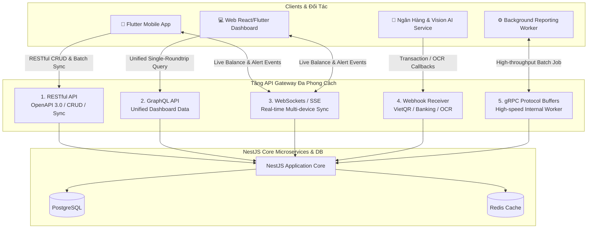

#### Ma Trận So Sánh Các Phong Cách API Trong Hệ Thống

| Phong Cách API | Giao Thức / Chuẩn | Khi Nào Sử Dụng Trong Finance Manager? | Ưu Điểm Nổi Bật |
|---|---|---|---|
| **RESTful API** | HTTP/1.1 & HTTP/2, JSON | Thao tác CRUD tiêu chuẩn, Xác thực JWT, Đồng bộ mẻ ngoại tuyến (`/sync`), Upload chứng từ. | Tiêu chuẩn hóa cao, dễ cache trên CDN/Nginx, OpenAPI 3.0 phong phú. |
| **GraphQL API** | HTTP POST, GraphQL Schema | Màn hình Home Dashboard phức tạp (lấy User, Wallets, Recent Trans, Budgets trong 1 query). | Loại bỏ triệt để **Over-fetching** và **Under-fetching**, Client tùy biến trường nhận. |
| **WebSockets / SSE** | WSS (WebSocket Secure) | Đồng bộ số dư tức thì khi cùng user mở app trên cả iPhone và iPad; Bắn cảnh báo vượt ngân sách real-time. | Giao tiếp 2 chiều độ trễ cực thấp (< 50ms), không cần polling. |
| **Webhook API** | HTTPS POST Callback | Nhận biến động số dư từ Ngân hàng (Open Banking / VietQR Pay) và nhận kết quả scan hóa đơn từ AI OCR. | Tích hợp bất đồng bộ phi tập trung, an toàn với HMAC-SHA256 Signature. |
| **gRPC API** | HTTP/2, Protocol Buffers | Xử lý tính toán báo cáo tổng hợp tài chính đa năm định kỳ với Background Worker. | Serialize nhị phân siêu nhanh, tiết kiệm 70% băng thông mạng so với JSON. |

---

### 5.5.2 Đặc Tả OpenAPI 3.0 / Swagger Đa Dạng Endpoints

Dưới đây là đặc tả OpenAPI 3.0 (YAML) được AI mở rộng cho nhiều luồng nghiệp vụ tài chính thực tế:

```yaml
openapi: 3.0.3
info:
  title: Finance Manager Multi-Service API Specification
  version: 2.0.0
  description: Tài liệu đặc tả API chuẩn hóa cho Mobile App, Web Client và Tích hợp Đối tác.
servers:
  - url: https://api.financemanager.app/api/v1
    description: Production Cloud Server
  - url: http://localhost:3000/api/v1
    description: Local Development Server

components:
  securitySchemes:
    bearerAuth:
      type: http
      scheme: bearer
      bearerFormat: JWT

  schemas:
    WalletTransferDto:
      type: object
      required:
        - sourceWalletId
        - destinationWalletId
        - amount
      properties:
        sourceWalletId:
          type: string
          format: uuid
          example: "a1b2c3d4-e5f6-7a8b-9c0d-1e2f3a4b5c6d"
        destinationWalletId:
          type: string
          format: uuid
          example: "f6e5d4c3-b2a1-0987-6543-21fedcba0987"
        amount:
          type: number
          format: double
          minimum: 1000
          example: 500000.00
        transferFee:
          type: number
          format: double
          default: 0
          example: 3300.00
        note:
          type: string
          example: "Chuyển tiền tiết kiệm từ Techcombank sang Momo"

    OcrScanResponseDto:
      type: object
      properties:
        success:
          type: boolean
          example: true
        detectedMerchant:
          type: string
          example: "Siêu thị WinMart+ Thăng Long"
        detectedAmount:
          type: number
          example: 185000.00
        suggestedCategoryId:
          type: string
          format: uuid
          example: "3fa85f64-5717-4562-b3fc-2c963f66afa6"
        confidenceScore:
          type: number
          format: float
          example: 0.94
        rawLineItems:
          type: array
          items:
            type: object
            properties:
              itemName:
                type: string
                example: "Sữa tươi TH True Milk 1L"
              itemPrice:
                type: number
                example: 38000.00

    SavingsGoalDepositDto:
      type: object
      required:
        - walletId
        - amount
      properties:
        walletId:
          type: string
          format: uuid
        amount:
          type: number
          minimum: 1000
          example: 2000000.00
        note:
          type: string
          example: "Trích thưởng tháng 10 vào quỹ mua xe"

    CashFlowReportDto:
      type: object
      properties:
        totalIncome:
          type: number
          example: 25000000.00
        totalExpense:
          type: number
          example: 14200000.00
        netSavings:
          type: number
          example: 10800000.00
        savingsRatePercentage:
          type: number
          example: 43.2
        categoriesBreakdown:
          type: array
          items:
            type: object
            properties:
              categoryName:
                type: string
                example: "Ăn uống"
              amount:
                type: number
                example: 6500000.00
              percentage:
                type: number
                example: 45.7

paths:
  /wallets/transfer:
    post:
      summary: Chuyển khoản tiền tệ nội bộ giữa 2 ví
      description: Tự động trừ tiền ví nguồn, cộng tiền ví đích và ghi nhận phí chuyển khoản trong một Database Transaction duy nhất.
      security:
        - bearerAuth: []
      parameters:
        - in: header
          name: X-Idempotency-Key
          schema:
            type: string
            format: uuid
          required: true
          description: Khóa bất biến chống trừ tiền 2 lần khi mạng retry.
      requestBody:
        required: true
        content:
          application/json:
            schema:
              $ref: '#/components/schemas/WalletTransferDto'
      responses:
        '200':
          description: Chuyển khoản thành công
        '400':
          description: Số dư ví nguồn không đủ hoặc trùng ví nguồn-đích.

  /ocr/scan-receipt:
    post:
      summary: Tải lên ảnh hóa đơn để Vision AI nhận diện tự động
      description: Trích xuất tên nhà bán hàng, số tiền, ngày giờ và gợi ý danh mục chi tiêu tự động.
      security:
        - bearerAuth: []
      requestBody:
        required: true
        content:
          multipart/form-data:
            schema:
              type: object
              properties:
                receiptImage:
                  type: string
                  format: binary
                  description: File ảnh chụp JPEG/PNG tối đa 5MB.
      responses:
        '200':
          description: Phân tích hóa đơn thành công
          content:
            application/json:
              schema:
                $ref: '#/components/schemas/OcrScanResponseDto'

  /reports/cash-flow:
    get:
      summary: Lấy báo cáo dòng tiền và cơ cấu chi tiêu đa chiều
      security:
        - bearerAuth: []
      parameters:
        - in: query
          name: startDate
          schema:
            type: string
            format: date
          required: true
          example: "2026-10-01"
        - in: query
          name: endDate
          schema:
            type: string
            format: date
          required: true
          example: "2026-10-31"
        - in: query
          name: walletIds
          schema:
            type: array
            items:
              type: string
              format: uuid
          description: Lọc theo danh sách ví cụ thể (để trống nếu lấy tất cả)
      responses:
        '200':
          description: Kết quả báo cáo thống kê thành công
          content:
            application/json:
              schema:
                $ref: '#/components/schemas/CashFlowReportDto'

  /savings-goals/{id}/deposit:
    post:
      summary: Nạp tiền tích lũy vào Mục tiêu tiết kiệm
      security:
        - bearerAuth: []
      parameters:
        - in: path
          name: id
          required: true
          schema:
            type: string
            format: uuid
      requestBody:
        required: true
        content:
          application/json:
            schema:
              $ref: '#/components/schemas/SavingsGoalDepositDto'
      responses:
        '200':
          description: Đã nạp tiền vào quỹ tiết kiệm và cập nhật tiến độ
```

---

### 5.5.3 Hợp Đồng GraphQL Schema Mẫu (`backend/src/schema.gql`)

Để tối ưu hóa màn hình Home Dashboard trên ứng dụng di động chỉ trong 1 chuyến bay mạng (Single Roundtrip), AI đã thiết kế lược đồ GraphQL Schema:

```graphql
# GraphQL Schema phục vụ truy vấn tối ưu cho Home Dashboard

type UserProfile {
  id: ID!
  email: String!
  fullName: String!
  baseCurrency: String!
}

type WalletSummary {
  id: ID!
  name: String!
  type: String!
  balance: Float!
  currency: String!
  isExcludedFromTotal: Boolean!
}

type BudgetProgress {
  id: ID!
  categoryName: String!
  categoryColor: String!
  limitAmount: Float!
  spentAmount: Float!
  spentPercentage: Float!
  alertLevel: String! # NORMAL, WARNING_80, CRITICAL_100
}

type TransactionItem {
  id: ID!
  walletName: String!
  categoryName: String!
  categoryIcon: String!
  amount: Float!
  type: String!
  transactionDate: String!
  note: String
}

type DashboardPayload {
  user: UserProfile!
  netWorth: Float!
  totalIncomeThisMonth: Float!
  totalExpenseThisMonth: Float!
  wallets: [WalletSummary!]!
  topBudgets: [BudgetProgress!]!
  recentTransactions(limit: Int = 5): [TransactionItem!]!
}

type Query {
  # Truy vấn duy nhất lấy toàn bộ dữ liệu màn hình chính
  getDashboardOverview: DashboardPayload!
  
  # Truy vấn phân trang lịch sử giao dịch bằng Cursor
  getTransactionFeed(cursor: String, limit: Int = 20, walletId: ID): TransactionFeedConnection!
}

type Mutation {
  quickAddTransaction(
    walletId: ID!
    categoryId: ID!
    amount: Float!
    type: String!
    note: String
  ): TransactionItem!
}

type Subscription {
  # Lắng nghe cập nhật số dư thời gian thực khi có giao dịch mới
  walletBalanceChanged(userId: ID!): WalletSummary!
}
```

---

### 5.5.4 Giao Thức WebSockets & Đồng Bộ Đa Thiết Bị Thời Gian Thực

Khi người dùng mở ứng dụng cùng lúc trên iPhone và Web Dashboard:
1. **Thiết lập kết nối**: Client kết nối tới `wss://api.financemanager.app/realtime` kèm JWT token trong query `?token=...`.
2. **Channel Subscription**: Client tự động tham gia vào Private Room `user_{userId}`.
3. **Event Payloads**:
   ```json
   // Sự kiện: Số dư ví thay đổi tức thì
   {
     "event": "wallet:balance_updated",
     "timestamp": "2026-10-13T06:30:00Z",
     "payload": {
       "walletId": "7c9e6679-7425-40de-944b-e07fc1f90ae7",
       "walletName": "Tiền mặt",
       "oldBalance": 1500000.00,
       "newBalance": 1450000.00,
       "triggerTransactionId": "e4eaaaf2-d142-11e1-b3e4-080027620cdd"
     }
   }
   ```
   ```json
   // Sự kiện: Cảnh báo ngân sách vượt ngưỡng
   {
     "event": "budget:alert_triggered",
     "timestamp": "2026-10-13T06:30:01Z",
     "payload": {
       "budgetId": "b4a1c2d3-...",
       "categoryName": "Ăn uống",
       "spentPercentage": 86.5,
       "alertLevel": "WARNING_80",
       "message": "Cảnh báo: Bạn đã chi tiêu 86.5% ngân sách Ăn uống tháng này!"
     }
   }
   ```

---

### 5.5.5 Các Chiến Lược & Mô Hình API Nâng Cao (Advanced API Patterns)

#### 1. Chiến Lược Phân Trang: Offset-based vs. Cursor-based Pagination
- **Offset Pagination** (`?page=2&limit=20`): Phù hợp cho trang Quản trị Admin nơi người dùng cần nhảy trực tiếp đến trang số 5 hoặc trang cuối.
- **Cursor-based Pagination** (`?cursor=uuid_xyz&limit=20`): Bắt buộc áp dụng cho Feed Lịch sử Giao dịch trên Mobile. 
  * *Lý do*: Nếu dùng Offset Pagination, khi người dùng đang cuộn danh sách mà phát sinh thêm 1 giao dịch mới được tạo ở đầu danh sách, toàn bộ bản ghi sẽ bị đẩy lùi 1 vị trí $\to$ Người dùng sẽ thấy **bản ghi bị hiển thị trùng lặp 2 lần**. Cursor-based sử dụng mốc `(transactionDate, id)` làm điểm neo tuyệt đối, loại bỏ 100% hiện tượng trùng lặp hoặc nhảy trang.

#### 2. Phân Tầng Giới Hạn Tốc Độ (Tiered Rate Limiting Với Redis Token Bucket)
AI đã thiết kế thuật toán giới hạn tần suất theo phân tầng người dùng thông qua NestJS Interceptor:
- **Free Tier**: Tối đa 60 requests / phút.
- **Premium / Pro Tier**: Tối đa 300 requests / phút (ưu tiên xử lý nhanh các tác vụ OCR hóa đơn).
- Mã lỗi trả về khi vi phạm: `HTTP 429 Too Many Requests` kèm Headers:
  + `X-RateLimit-Limit: 60`
  + `X-RateLimit-Remaining: 0`
  + `Retry-After: 42` (Số giây cần chờ trước khi thử lại).

#### 3. Cơ Chế Khóa Bất Biến Idempotency Nâng Cao (Distributed Locking)
Để triệt tiêu lỗi mất tiền do chạm nút Lưu nhiều lần hoặc mạng chập chờn timeout tự retry, Header `X-Idempotency-Key` được xử lý với Redis:

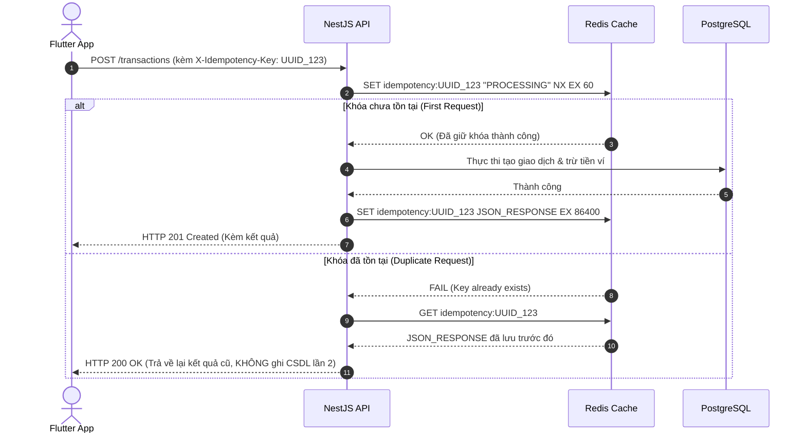

#### 4. API Nhập Sao Kê Ngân Hàng Hàng Loạt (Bulk Operations API)
Hỗ trợ nhập 100 - 500 giao dịch từ file Excel/CSV sao kê ngân hàng:
- Endpoint: `POST /api/v1/transactions/bulk-import`
- Xử lý bất đồng bộ theo luồng Chunking (mỗi mẻ 50 records) với khả năng Rollback cục bộ nếu có lỗi định dạng số tiền hoặc ngày tháng.

---

## 5.6 Mô Hình Thiết Kế (Design Patterns)

### 5.6.1 Ma Trận Ứng Dụng Design Patterns Trong Finance Manager

AI đã đề xuất áp dụng các mẫu thiết kế hướng đối tượng (GoF Design Patterns) kết hợp với các mẫu hiện đại nhằm đảm bảo tính linh hoạt và dễ mở rộng của mã nguồn:

| Phân Loại | Tên Mẫu Thiết Kế | Vị Trí Hiện Thực Trong Dự Án | Mục Đích Nghiệp Vụ Cụ Thể |
|---|---|---|---|
| **Creational (Khởi tạo)** | **Factory Method** | `backend/src/transactions/factories` | Tạo các đối tượng giao dịch (`Income`, `Expense`, `Transfer`) với các ràng buộc số dư và logic thuế khác nhau. |
| **Creational (Khởi tạo)** | **Builder Pattern** | `backend/src/reports/builders` | Xây dựng báo cáo tài chính phức tạp (`FinancialReportBuilder`) với nhiều bộ lọc động (theo ví, ngày, loại giao dịch, biểu đồ). |
| **Structural (Cấu trúc)** | **Repository Pattern** | `backend/src/prisma/repositories` & Flutter Data Layer | Tách biệt hoàn toàn tầng truy xuất dữ liệu khỏi Business Services, phục vụ viết Unit Test không cần kết nối Database. |
| **Structural (Cấu trúc)** | **Adapter Pattern** | `backend/src/currency/adapters` | Chuẩn hóa giao diện lấy tỷ giá ngoại tệ từ các bên thứ 3 (`VietcombankAdapter`, `ExchangeRateApiAdapter`). |
| **Structural (Cấu trúc)** | **Decorator Pattern** | `backend/src/common/decorators` | Mở rộng tính năng Controller: `@CurrentUser()`, `@AuditLog()`, `@Roles()`. |
| **Behavioral (Hành vi)** | **Strategy Pattern** | `backend/src/transactions/sync/strategies` | Lựa chọn linh hoạt chiến lược giải quyết xung đột đồng bộ (`LastWriteWinsStrategy`, `ServerWinsStrategy`, `ManualMergeStrategy`). |
| **Behavioral (Hành vi)** | **Observer / Event Pattern** | `NestJS EventEmitter2` & Flutter BLoC | Khi tạo giao dịch thành công: Tự động bắn event cập nhật số dư, kiểm tra ngân sách và gửi thông báo mà không làm tăng coupling. |
| **Behavioral (Hành vi)** | **Chain of Responsibility** | `backend/src/transactions/pipes` | Chuỗi kiểm duyệt giao dịch: `FormatCheck` $\to$ `BalanceCheck` $\to$ `DailyLimitCheck` $\to$ `AntiFraudCheck`. |

### 5.6.2 Hiện Thực Mẫu Thiết Kế Trọng Điểm

#### 1. Strategy Pattern: Chiến Lược Giải Quyết Xung Đột Đồng Bộ Ngoại Tuyến

```typescript
// backend/src/transactions/sync/strategies/sync-strategy.interface.ts

export interface SyncConflictPayload {
  clientRecord: {
    id: string;
    amount: number;
    note?: string;
    clientUpdatedAt: Date;
  };
  serverRecord: {
    id: string;
    amount: number;
    note?: string;
    updatedAt: Date;
  };
}

export interface ISyncStrategy {
  resolveConflict(payload: SyncConflictPayload): Promise<{
    winningRecord: 'CLIENT' | 'SERVER';
    appliedData: any;
  }>;
}

// Chiến lược Last-Write-Wins (Mặc định cho v1.0)
@Injectable()
export class LastWriteWinsStrategy implements ISyncStrategy {
  async resolveConflict(payload: SyncConflictPayload) {
    const clientTime = new Date(payload.clientRecord.clientUpdatedAt).getTime();
    const serverTime = new Date(payload.serverRecord.updatedAt).getTime();

    if (clientTime > serverTime) {
      return {
        winningRecord: 'CLIENT',
        appliedData: payload.clientRecord,
      };
    }

    return {
      winningRecord: 'SERVER',
      appliedData: payload.serverRecord,
    };
  }
}
```

#### 2. Factory Method: Khởi Tạo Xử Lý Giao Dịch Đa Dạng

```typescript
// backend/src/transactions/factories/transaction-processor.factory.ts

export abstract class TransactionProcessor {
  abstract validate(dto: CreateTransactionDto, walletBalance: number): void;
  abstract calculateNewBalance(currentBalance: number, amount: number): number;
}

export class ExpenseProcessor extends TransactionProcessor {
  validate(dto: CreateTransactionDto, walletBalance: number): void {
    if (dto.amount <= 0) {
      throw new BadRequestException('Số tiền chi tiêu phải lớn hơn 0');
    }
    // Cho phép số dư âm nếu ví là thẻ tín dụng (sẽ mở rộng v2.0)
  }

  calculateNewBalance(currentBalance: number, amount: number): number {
    return currentBalance - amount;
  }
}

export class IncomeProcessor extends TransactionProcessor {
  validate(dto: CreateTransactionDto): void {
    if (dto.amount <= 0) {
      throw new BadRequestException('Số tiền thu nhập phải lớn hơn 0');
    }
  }

  calculateNewBalance(currentBalance: number, amount: number): number {
    return currentBalance + amount;
  }
}

export class TransferProcessor extends TransactionProcessor {
  validate(dto: CreateTransactionDto, walletBalance: number): void {
    if (!dto.destinationWalletId) {
      throw new BadRequestException('Giao dịch chuyển tiền phải có ví nhận');
    }
    if (dto.walletId === dto.destinationWalletId) {
      throw new BadRequestException('Ví nguồn và ví đích không được trùng nhau');
    }
    if (walletBalance < dto.amount) {
      throw new BadRequestException('Số dư ví nguồn không đủ để thực hiện chuyển tiền');
    }
  }

  calculateNewBalance(currentBalance: number, amount: number): number {
    return currentBalance - amount;
  }
}

@Injectable()
export class TransactionProcessorFactory {
  getProcessor(type: TransactionType): TransactionProcessor {
    switch (type) {
      case TransactionType.EXPENSE:
        return new ExpenseProcessor();
      case TransactionType.INCOME:
        return new IncomeProcessor();
      case TransactionType.TRANSFER:
        return new TransferProcessor();
      default:
        throw new BadRequestException(`Loại giao dịch không được hỗ trợ: ${type}`);
    }
  }
}
```

#### 3. Observer / Event-Driven Pattern: Phản Ứng Độc Lập Khi Tạo Giao Dịch

```typescript
// backend/src/transactions/events/transaction-created.event.ts

export class TransactionCreatedEvent {
  constructor(
    public readonly transactionId: string,
    public readonly userId: string,
    public readonly walletId: string,
    public readonly categoryId: string,
    public readonly amount: number,
    public readonly type: TransactionType,
  ) {}
}

// backend/src/budgets/listeners/check-budget.listener.ts
@Injectable()
export class CheckBudgetListener {
  constructor(
    private readonly budgetsService: BudgetsService,
    private readonly notificationsService: NotificationsService,
  ) {}

  @OnEvent('transaction.created', { async: true })
  async handleTransactionCreated(event: TransactionCreatedEvent) {
    if (event.type !== TransactionType.EXPENSE) return;

    // Kiểm tra ngân sách chạy ngầm bất đồng bộ không làm chậm phản hồi API
    const alertResult = await this.budgetsService.checkAndIncrementSpent(
      event.userId,
      event.categoryId,
      event.amount,
    );

    if (alertResult && alertResult.shouldNotify) {
      await this.notificationsService.sendPushNotification(
        event.userId,
        alertResult.title,
        alertResult.body,
      );
    }
  }
}
```

### 5.6.3 AI Trong Nhận Diện Anti-Patterns & Tự Động Tái Cấu Trúc (Refactoring)

Trong quá trình phát triển mã nguồn, AI được thiết lập làm rào chắn kiểm toán mã nguồn (Static Code Architecture Guard). AI tự động quét và ngăn chặn:

1. **God Class Anti-Pattern**: Khi `TransactionsService` phình to quá 500 dòng và kiêm nhiệm việc gửi push notification, format tiền tệ và tính toán báo cáo $\to$ AI tự động đề xuất phân tách thành `TransactionEventPublisher`, `CurrencyFormatterHelper` và `BudgetEvaluator`.
2. **Anemic Domain Model**: Khi Entities chỉ là các túi chứa dữ liệu (Data Bags) còn toàn bộ logic bị phân tán trong các Controller $\to$ AI gợi ý đưa các phương thức nghiệp vụ hợp lệ vào Domain Entities.
3. **Leaky Abstraction**: Khi Controller của NestJS tương tác trực tiếp với các câu lệnh SQL thô hoặc Prisma Model mà bỏ qua tầng Service $\to$ AI báo lỗi vi phạm ranh giới phân lớp Clean Architecture.

---

## 5.7 Khung Kiểm Toán Kiến Trúc Bằng AI (AI Architecture Review Checklist)

Mọi thay đổi kiến trúc hoặc bổ sung module trong dự án **Finance Manager** bắt buộc phải vượt qua 10 tiêu chí thẩm định tự động sau:

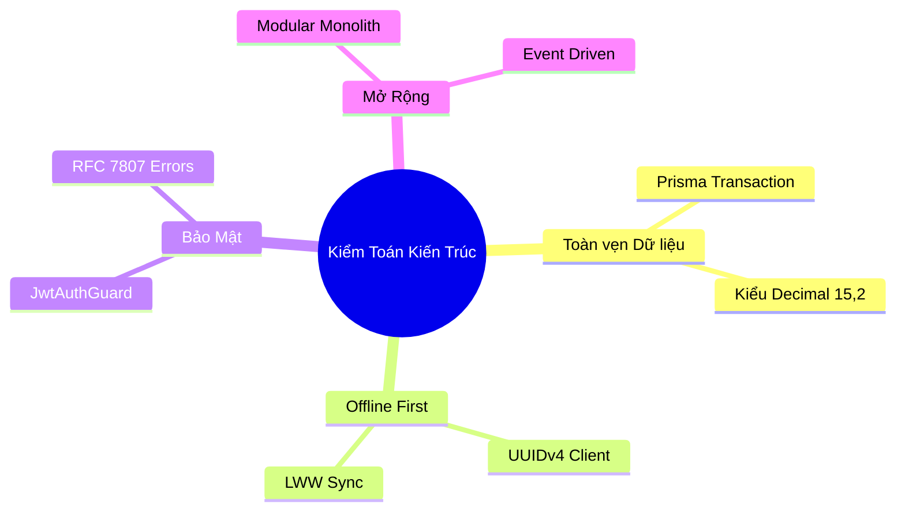

| STT | Tiêu Chí Kiểm Toán Kiến Trúc | Trạng Thái Thẩm Định | Công Cụ & Cơ Chế Kiểm Tra |
|---|---|---|---|
| 1 | **Ranh giới Domain (Module Boundaries)** | ✅ Đạt chuẩn | Cấm phụ thuộc vòng (Circular Dependency), module giao tiếp qua Service Interfaces. |
| 2 | **Khả năng Offline-First** | ✅ Đạt chuẩn | Khóa chính bắt buộc dùng UUIDv4, có trường `clientCreatedAt`, hỗ trợ LWW Sync. |
| 3 | **Toàn vẹn Dữ liệu Tài chính** | ✅ Đạt chuẩn | Cập nhật số dư ví bắt buộc bọc trong Prisma `$transaction`, số tiền dùng kiểu `Decimal(15,2)`. |
| 4 | **Bảo mật Xác thực & Phân quyền** | ✅ Đạt chuẩn | Toàn bộ endpoint yêu cầu `@UseGuards(JwtAuthGuard)`, cấm lộ mật khẩu ra response. |
| 5 | **Chuẩn hóa API Contracts** | ✅ Đạt chuẩn | Mọi endpoint đều có Swagger DTO decorator (`@ApiProperty`), lỗi trả về chuẩn RFC 7807. |
| 6 | **Chỉ số Hiệu năng & Indexing** | ✅ Đạt chuẩn | Các trường khóa ngoại và trường lọc (`userId`, `transactionDate`) đều được đánh B-Tree Index. |
| 7 | **Khả năng Kiểm thử (Testability)** | ✅ Đạt chuẩn | Tầng Business Service hoàn toàn decoupled, có thể mock Repository 100% trong Unit Test. |
| 8 | **Chống Tấn Công Lặp Lại (Idempotency)** | ✅ Đạt chuẩn | Giao dịch nhạy cảm có cơ chế chặn duplicate submit qua UUID và Redis Cache. |
| 9 | **Kiến trúc Sự kiện (Event Decoupling)** | ✅ Đạt chuẩn | Cảnh báo ngân sách và bắn push notification xử lý bất đồng bộ qua Internal Event Bus. |
| 10 | **Đồng bộ Tài liệu & Diagram-as-Code** | ✅ Đạt chuẩn | Mọi thay đổi schema đều được cập nhật tự động vào C4 Diagrams và Mermaid ERD. |

---

## 5.8 Tổng Kết

Việc áp dụng Trí tuệ Nhân tạo vào **Thiết kế & Kiến trúc Phần mềm** trong dự án **Finance Manager** đã mang lại bước nhảy vọt về năng suất và độ tin cậy kỹ thuật:
- **Tốc độ hiện thực hóa**: Rút ngắn thời gian từ ý tưởng thiết kế kiến trúc đến bộ khung mã nguồn hoàn chỉnh từ 3 tuần xuống còn 3 ngày làm việc.
- **Tính nhất quán tuyệt đối**: Giữ cho tài liệu kiến trúc, sơ đồ UML, lược đồ CSDL Prisma và hợp đồng API OpenAPI luôn đồng bộ 100%.
- **Chất lượng mã nguồn bền vững**: Ngăn chặn rò rỉ ranh giới kiến trúc ngay từ giai đoạn thiết kế, tạo nền tảng vững chắc để ứng dụng phát triển từ một giải pháp cá nhân nhỏ gọn thành một nền tảng tài chính quy mô lớn.
